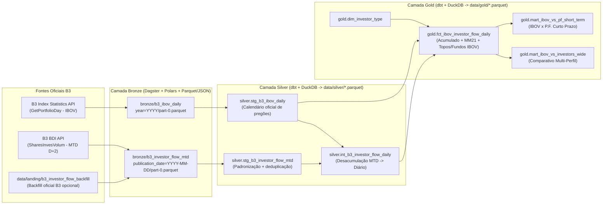

# GringoLake — Pipeline Medalhão B3 (IBOV × Fluxo de Investidores)

[](https://github.com/leoserpa/gringolake/actions/workflows/ci.yml)
[](https://leoserpa.github.io/gringolake/)
[](LICENSE)
[](pyproject.toml)
[](#arquitetura)

Pipeline local de engenharia de dados em arquitetura **Medalhão (Bronze / Silver / Gold)** construído com **Dagster + Polars + DuckDB + dbt**, consumindo exclusivamente fontes oficiais da **B3** para alimentar gráficos comparativos entre **Ibovespa (IBOV)**, **Fluxo Acumulado por Perfil de Investidor** (Estrangeiro, Institucional, Pessoa Física, Instituições Financeiras e Outros) e **Média Móvel de 21 pregões (MM21)**.

## Quick Start

Pré-requisitos: Python 3.12+ e [`uv`](https://docs.astral.sh/uv/).

```bash
# 1. Instalar dependências
uv sync --group dev

# 2. Validar definições Dagster + dbt
uv run dg check defs

# 3. Executar o pipeline Medalhão ponta a ponta (Bronze -> Silver -> Gold + Asset Checks)
uv run dg launch --job b3_medallion_full_refresh

# 4. Rodar todos os testes (Python + dbt unit/data tests + invariante soma-zero B3)
uv run pytest -v
(cd dbt_gringolake && uv run dbt test --profiles-dir .)

# 5. Subir a interface web do Dagster (linhagem, metadados, asset checks e agenda)
uv run dg dev

# 6. Subir o dashboard interativo em Evidence.dev (GringoLake Terminal)
cd reports && npm install && npm run sources && npm run dev
```

## Comandos

| Comando | Descrição |
| --- | --- |
| `uv run dg check defs` | Valida YAML dos componentes e carrega todo o grafo Dagster + dbt |
| `uv run dg launch --assets bronze/b3_ibov_daily,bronze/b3_investor_flow_mtd` | Materializa apenas a camada Bronze a partir das APIs oficiais da B3 |
| `uv run dg launch --job b3_medallion_full_refresh` | Executa o pipeline completo Medalhão (Bronze → Silver → Gold) + Asset Checks |
| `(cd dbt_gringolake && uv run dbt build --profiles-dir .)` | Executa modelos Silver/Gold, unit tests, data tests e exporta Parquet |
| `uv run pytest -v` | Roda testes unitários Python dos clientes B3 e escrita atômica Bronze |
| `uv run ruff check src tests` | Executa análise estática/lint no código Python |
| `uv run dg dev` | Inicia a UI web local do Dagster |
| `(cd reports && npm run sources:strict && npm run build:strict)` | Gera o build estático do dashboard Evidence.dev (`reports/build/`) a partir dos Parquets Silver/Gold |
| `bash scripts/check_docs_drift.sh` | Verifica via Git se algum documento/ADR ficou defasado em relação ao código |

*(Atalhos equivalentes existem em [`Makefile`](Makefile) caso `make` esteja instalado no ambiente.)*

## Arquitetura



### Documentação Técnica e Decisões Arquiteturais (ADRs)

- **Índice de ADRs:** [`docs/decisions/README.md`](docs/decisions/README.md)
  - [ADR-001](docs/decisions/001-local-modern-data-stack-medallion.md) — Stack Medalhão local (`Dagster + Polars + DuckDB + dbt`)
  - [ADR-002](docs/decisions/002-official-b3-data-sources-only.md) — Fontes oficiais B3 (`GetPortfolioDay` + BDI `SharesInvesVolum`), janela `D-21`, lag `D+2` e backfill
  - [ADR-003](docs/decisions/003-mtd-deaccumulation-using-ibov-calendar.md) — Desacumulação MTD → Diário usando o calendário oficial de pregões do IBOV
  - [ADR-004](docs/decisions/004-dual-storage-duckdb-and-zstd-parquet.md) — Materialização dupla DuckDB + Parquet ZSTD e resolução de caminhos no `DbtProjectComponent`
  - [ADR-005](docs/decisions/005-multi-layer-data-quality-and-zero-sum-invariant.md) — Qualidade em 3 camadas e invariante contábil soma-zero da B3
- **Dicionário de Dados (Bronze / Silver / Gold):** [`docs/data-dictionary.md`](docs/data-dictionary.md)
- **Guia para Agentes e Armadilhas Conhecidas:** [`AGENTS.md`](AGENTS.md)
- **Contrato de Backfill Histórico Oficial B3:** [`data/landing/b3_investor_flow_backfill/README.md`](data/landing/b3_investor_flow_backfill/README.md)
- **Histórico de Mudanças:** [`CHANGELOG.md`](CHANGELOG.md)

### Automação Diária e Cuidados Operacionais

- **Schedule pós-SLA:** `b3_daily_eod_schedule` executa `b3_medallion_full_refresh` de **segunda a sexta às 21h (`America/Sao_Paulo`)**, 1 hora após o SLA oficial das `20:00 BRT` informado no payload do BDI da B3. Todas as datas de coleta usam explicitamente o fuso `America/Sao_Paulo` para evitar virada prematura em ambientes UTC.
- **Lock de escrita no DuckDB:** ao conectar ferramentas de BI (Power BI, Metabase, notebooks), leia preferencialmente **`data/gold/*.parquet`** ou abra o DuckDB em modo `read_only=True` para não bloquear a execução diária das 21h.
- **Retenção `D-21` da B3:** se a máquina ficar desligada por mais de ~21 pregões consecutivos, a API pública perde os dias mais antigos; para operação contínua sem depender do PC local, execute `uv run dg launch --job b3_medallion_full_refresh` em um servidor pequeno ou workflow agendado.

## Consumo para os 4 Gráficos (Camada Gold)

Os dados finais ficam sincronizados em `data/warehouse/gringolake.duckdb` (schemas `silver` e `gold`) e em `data/gold/*.parquet`:

- **Gráfico 1 — `Relação: IBOV x P.F. (CURTO PRAZO)`:** `gold.mart_ibov_vs_pf_short_term`
  - `trading_date` (eixo X, últimos 160 pregões), `pf_cum_short_term_bi_brl` + `pf_cum_short_term_ma21_bi_brl` (eixo Y esquerdo; filtre `has_full_ma21_window = true` para iniciar a MM21 somente após 21 pregões), `ibov_close` + `ibov_label_points` (eixo Y direito), `is_pf_below_ma21` (faixas de cruzamento).
- **Gráficos 2, 3 e 4 — `COMPARATIVO: IBOVESPA X ESTRANG X INSTIT. X P.F. - R$ (mil)`:** `gold.mart_ibov_vs_investors_wide` (wide, também com `has_full_ma21_window`) ou `gold.fct_ibov_investor_flow_daily` (long)
  - Pessoa Física: `pf_cum_bi_brl` + `pf_cum_ma21_bi_brl` vs. `ibov_close`
  - Institucional: `instit_cum_bi_brl` + `instit_cum_ma21_bi_brl` vs. `ibov_close`
  - Estrangeiro: `estrang_cum_bi_brl` + `estrang_cum_ma21_bi_brl` vs. `ibov_close`

```python
import duckdb

con = duckdb.connect("data/warehouse/gringolake.duckdb", read_only=True)
df = con.execute("""
    SELECT trading_date, ibov_close, ibov_label_points,
           estrang_cum_bi_brl, instit_cum_bi_brl, pf_cum_bi_brl, pf_cum_ma21_bi_brl
    FROM gold.mart_ibov_vs_investors_wide
    ORDER BY trading_date
""").pl()
print(df.tail(10))
```

## Contribuição e Verificação

Antes de abrir PR ou consolidar alterações:
1. Rode `uv run ruff check src tests`, `uv run pytest -v` e `(cd dbt_gringolake && uv run dbt test --profiles-dir .)`.
2. Valide o grafo com `uv run dg check defs`.
3. Para mudanças arquiteturais, crie um novo ADR em `docs/decisions/` e adicione entrada datada em `CHANGELOG.md` (append-only).
4. Verifique drift documental com `bash scripts/check_docs_drift.sh`.

## Licença e Aviso sobre Dados

Este projeto é distribuído sob a licença **[GNU General Public License v3.0 (GPL-3.0)](LICENSE)** — mantida integralmente sem alterações no arquivo [`LICENSE`](LICENSE), conforme exigido pela Free Software Foundation.

| Permissão / Condição | Resumo prático |
| --- | --- |
| **Uso comercial, estudo e modificação** | Permitidos livremente |
| **Redistribuição e obras derivadas** | Devem manter a licença **GPL-3.0**, os avisos de copyright e disponibilizar o código-fonte |
| **Garantia e responsabilidade** | Software fornecido *"como está"*, sem garantias |

**Copyright © 2026 Leonardo Serpa.**

> **Aviso sobre dados de mercado:** a licença GPL-3.0 cobre exclusivamente o código-fonte, os modelos dbt e a documentação deste repositório. Os dados financeiros ingeridos em tempo de execução são públicos e de titularidade da **B3 S.A. – Brasil, Bolsa, Balcão** (sujeitos aos termos de uso da B3). Este projeto tem finalidade estritamente técnica e analítica e **não constitui recomendação de investimento**.
